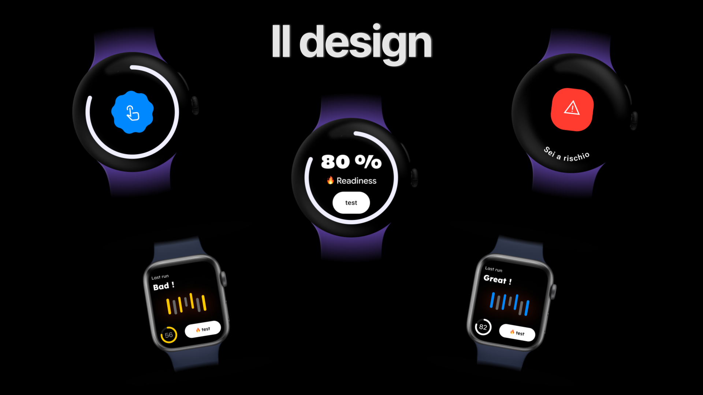

# Astro

A fit-for-duty check for astronauts, on the watch.

Built for the NASA Space Apps Challenge 2026, challenge "Health Monitoring Software for Astronauts".

## The problem

On the ISS, astronauts call it "space fog": slow reflexes and fuzzy thinking after too little sleep. The dangerous part is that a tired person usually doesn't notice. They feel fine, they say they're fine, and then they make a mistake during an EVA or a maneuver.

Commercial wearables measure the body: heart rate, blood oxygen. None of them tell you whether your head is actually in the game.

## What it does

Astro adds a short reaction test to the watch and turns the result into a single readiness number.

The screen goes black. A circle appears. You tap it as fast as you can. The test runs from 30 seconds to 3 minutes, then compares your times against your own normal and returns green, yellow, or red. That score is combined with heart rate and blood oxygen into one readiness number from 0 to 100.

The test is NASA's own. It has run on the ISS since 2009 on the onboard laptops. Astro moves it to the wrist, offline, next to the vital signs.

A few things it does beyond the number:

- Tells you when you feel fine but your reflexes say otherwise.
- Gives a short piece of advice after every test.
- Flags when it's time to call the flight surgeon, and waits out a blackout if it has to.
- Shows your last seven sessions, so a slow decline over bad nights is easy to see.

## Where it runs

It runs on the watch, and only on the watch: a Wear OS watch like the Pixel Watch, and an Apple Watch. There is no phone app, and it needs no connection to work.

## Presentation

Slides: [assets/presentazione.pptx](./assets/presentazione.pptx)
